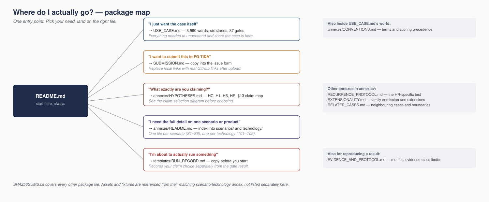

# When the controls work but the system fails

**FG-TIDA contributor use-case draft v0.9.3 · 29 September 2026 · open to revision**

**[Read the case](USE_CASE.md) · [Explore the annexes](annexes/README.md) · [Prepare a run](templates/RUN_RECORD.md)**

Six failure scenarios, three implementation walkthroughs, nine technology profiles and explicit hypotheses for review. This directory is a self-contained publication package. It contains the complete case-scope material; no historical archive or subsequent specification is required to read it.

**6 scenarios · 3 implementation walkthroughs · 9 technology profiles · 37 acceptance gates**

> [!NOTE]
> The profiles are documentary implementation walkthroughs, not nine executed product benchmarks.

## Research objectives

UC-21 asks five related questions. Each study selects its question before choosing the scenario, technology and comparison route.

| Objective | What the study seeks to establish | Governing source |
|---|---|---|
| Decision correctness and legitimate continuity | Whether the selected configuration meets the scenario's decision, authority, effect and timing conditions while allowing justified activity. | [Case acceptance plans](USE_CASE.md#6-six-quality-plans-visible-acceptance-criteria) |
| Effectiveness of existing controls | Whether a competent conventional configuration, including the reinforced R1, corrects the selected failure. Successful existing defences receive credit. | [R0/R1/R2 comparisons](USE_CASE.md#5-select-prepare-and-run-one-experiment) |
| Recurrence after correction | Whether an admitted material change brings back the same failure while the successfully corrected R1 and its adaptation remain active. | [HR recurrence protocol](annexes/RECURRENCE_PROTOCOL.md#annex-r) |
| Common causal pathway | Whether an admissible transfer, qualification-loss, material-change and reuse pathway can produce the independently defined failure in each declared family. | [HC causal protocol](annexes/HYPOTHESES.md#2-the-principal-hypothesis-of-causal-sufficiency) |
| Sufficient common response | Whether a declared communication-and-processing mechanism provides timely warning and authorized response while preserving legitimate activity across its registered scope. | [HS response protocol](annexes/HYPOTHESES.md#9a-the-hypothesis-of-a-sufficient-common-response) |

[H1–H6](annexes/HYPOTHESES.md#8-the-six-canonical-hypotheses-and-their-refutation-tests) supply additional, separately selected contrasts. The [claim-selection guide](annexes/HYPOTHESES.md#13-claim-selection) and [run record](templates/RUN_RECORD.md) keep a case outcome separate from the hypothesis conclusion.

## Start here

[Open the scalable figure](assets/reading/package_map.svg). The accompanying text remains the complete reference.

1. Read [USE_CASE.md](USE_CASE.md): the principal document, **3,590 words**, with scenario selection, preparation, execution and all **37 acceptance gates**. It frames and scores a declared case experiment. For a hypothesis claim, select HC, HR, HS or the relevant H1–H6 contrast using Section 5 and its linked protocol.
2. Read [the current hypotheses](annexes/HYPOTHESES.md): **HC, H1–H6 and HS**, with context definitions, six witness candidates and their support/refutation procedures. This is the current hypothesis protocol, not the principles/requirements traceability document.
3. For detailed fixtures, full walkthroughs, measurements or extensions, use [the complete annex index](annexes/README.md). All **20 technical annexes** are included as separate Markdown files.
4. Copy [the run-record template](templates/RUN_RECORD.md) before execution; record the hypothesis separately from R0/R1/R2 and distinguish gate results from hypothesis conclusions.
5. Use [SUBMISSION.md](SUBMISSION.md) for the FG-TIDA proposal fields. It contains the same 37 proposed technical requirements, identified by scenario.

## The three walkthroughs

*R0 is the ordinary configuration; R1 reinforces it; R2 retains that reinforced configuration under an admitted context change, with its safeguards and generic adaptation active.*

| Route | What is tested |
|---|---|
| R0 | Ordinary competent implementation with its declared controls. |
| R1 | Strongly defended implementation, reinforced before freeze; effective existing controls receive credit. |
| R2 | That same frozen R1 after an admitted observable material context change, retaining safeguards and generic adaptation. Recurrence requires demonstrated baseline correction first. |

A strong conventional implementation may pass. Legitimate-activity controls prevent a deny-all pass. There is no fourth implementation route. The A–D causal trial conditions in the hypothesis protocol are independent experimental factors, and HS describes an unproven functional response hypothesis; neither is an additional technology walkthrough or an executed solution result.

## Hypotheses are included explicitly

| Claim | Location and scope |
|---|---|
| HC — common causal sufficiency | [Hypotheses, section 2](annexes/HYPOTHESES.md#2-the-principal-hypothesis-of-causal-sufficiency): an admissible configured transfer/loss/change/reuse pathway for every family; not causal necessity. |
| H1–H6 | [Hypotheses, section 8](annexes/HYPOTHESES.md#8-the-six-canonical-hypotheses-and-their-refutation-tests): all six full statements, empirical contrasts and operational refutation tests. |
| HS — sufficient common response | [Hypotheses, section 9A](annexes/HYPOTHESES.md#9a-the-hypothesis-of-a-sufficient-common-response): functional proposal and future tests, without a prescribed architecture or a claimed result. |
| HR — recurrence after demonstrated correction | [Recurrence protocol](annexes/RECURRENCE_PROTOCOL.md): the more specific R2 question for a nominated frozen implementation. It is related to HC, not identical to it. |

Both S4 failure outcomes—unauthorized action and silent loss of the wider finding—remain separately visible. A result on only one does not establish both.

## The case, the research method and the wider system

UC-21 defines the problem, scientific objectives, hypotheses, scenarios and case-level acceptance criteria. DDS is the research method used by studies that investigate selected questions from this case and from other cases. A campaign connects a particular UC-21 objective and scenario to a frozen research contract, executions, evidence and conclusions. Its results return to the selected case question and can inform a subsequent specification-selection review.

| What you want to understand | Where to read |
|---|---|
| The case, its objectives, claims and R0/R1/R2 comparisons | [Main case](USE_CASE.md), [hypotheses](annexes/HYPOTHESES.md) and [recurrence protocol](annexes/RECURRENCE_PROTOCOL.md) |
| The research method and its specification, architecture and implementation stages | [DDS method index](https://github.com/dakleyer/structural-awareness-contributions/blob/de677309abb674e39b811c0293f863e90310bf80/research/ecosystem-awareness/DDS_CANONICAL_METHOD_INDEX_v0.1.md) |
| The wider architecture and its Ecosystem Awareness, Regime Awareness and Minimum Sufficient Control contributions | [Ecosystem Positioning](https://github.com/dakleyer/structural-awareness-contributions/blob/de677309abb674e39b811c0293f863e90310bf80/architectural-contributions/ecosystem-positioning/README.md) |

The [existing S5 research discussion](https://github.com/FG-TIDA/use-cases/issues/21#issuecomment-6109154445) connects this case to a Simplified DDS Stage A exercise. The [S4/CDA discussion](https://github.com/FG-TIDA/use-cases/issues/21#issuecomment-6111953753) describes an optional follow-up with its own scope decision. These links preserve the existing exercises and identify proposed work. UC-21 R0/R1/R2 are comparison routes; DDS A/B/C distinguish research objects. Their relationship is recorded for each study.

The [submitted reading snapshot](https://github.com/dakleyer/use-cases/tree/aec08fb5b0fac2ee399372370e9ee2a82a2d5779/contributions/when-controls-work-system-fails) retains its original files. Follow-up work identifies the source versions it actually uses.

## Package contents

| Location | Contents |
|---|---|
| [USE_CASE.md](USE_CASE.md) | Main case; six stories, three routes, 37 gates, experiment instructions and assessment limits |
| [SUBMISSION.md](SUBMISSION.md) | Proposal form for FG-TIDA |
| [annexes/README.md](annexes/README.md) | Complete index: six scenarios, nine technology profiles and five common annexes |
| [annexes/CONVENTIONS.md](annexes/CONVENTIONS.md) | Working vocabulary, source-local labels and scoring precedence |
| [annexes/HYPOTHESES.md](annexes/HYPOTHESES.md) | Current hypothesis protocol and H1–H6 in full |
| [annexes/EXTENSIONALITY.md](annexes/EXTENSIONALITY.md) | Full family admission method and all six extension profiles |
| [annexes/RECURRENCE_PROTOCOL.md](annexes/RECURRENCE_PROTOCOL.md) | Corrected-baseline recurrence experiment and refutation |
| [annexes/EVIDENCE_AND_PROTOCOL.md](annexes/EVIDENCE_AND_PROTOCOL.md) | Shared protocol, full measurements, evidence classes and source boundaries |
| `annexes/scenarios/` and `annexes/technology/` | Full detailed scenario and technology annexes; all files linked in the index |
| `assets/` | Eleven scenario SVG figures plus three reading aids in SVG and PNG, referenced from the README and relevant annexes |
| `fixtures/S5-AWS/` | Four machine-readable JSON design artifacts, also printed in full in [T08](annexes/technology/T08.md) |
| [templates/RUN_RECORD.md](templates/RUN_RECORD.md) | Copyable record for claim selection, preregistration, gates and separate conclusions; not an additional technical annex |
| [SHA256SUMS.txt](SHA256SUMS.txt) | Preserved integrity manifest for the original submitted snapshot; not the maintained tree |
| [SHA256SUMS_2026-10-26.txt](SHA256SUMS_2026-10-26.txt) | Integrity manifest for every other file in this maintained package, including the historical manifest and preserved predecessors |

## Publish and maintain

Unzip the package and upload this directory’s contents together, preserving names and relative paths. Opening this README is the entry point; all case and annex links are local. The ZIP itself need not be committed as the working source. For a later correction, preserve the untouched predecessor before editing the affected Markdown or asset. Keep the original SHA256SUMS.txt unchanged with its submitted snapshot. Generate a new, separately dated manifest for a maintained edition; each such manifest identifies its own exact package cut and excludes itself. Preserve version history and do not maintain a second combined source copy.

To submit through the FG-TIDA issue form, copy the relevant text from SUBMISSION.md and replace its local file links with the actual published GitHub links after upload. A commit permalink can identify the exact submitted version. No destination URL is invented in this package.

## Evidence and publication status

The profiles are documentary implementation walkthroughs, not nine executed product benchmarks. The four JSON artifacts are non-deployed designs with placeholder functions; their full contents and implementation assumptions are in T08. Scenario facts are synthetic unless explicitly attributed. Hypotheses and proposed witnesses remain unproven; preserve successful defences and negative or inconclusive results.

Contributor: **The Integral Management Society / Tegrity.AI**. Contact: **Iván Abril Palma — ivan.abril@tegrity.ai**. This is a public contributor draft, not an adopted FG-TIDA standard. Original authorship and applicable source terms remain in force. Principles, specification traceability and historical preservation records are separate deliverables and are not included as case annexes here.

## Challenges, evaluation scenarios and recorded work

**Reading update — 12 October 2026.** UC-21's six failure families are the Challenges in this reader route; their original S1–S6 scenario labels and 00E–00J source mappings remain intact. Within DDS, an evaluation scenario relates a Challenge to a specified technology/configuration and declared conditions. The source method separately records the bounded base scenario and the technology mapping. Consult the [case conventions](annexes/CONVENTIONS.md), [DDS Challenge definition](https://github.com/dakleyer/structural-awareness-contributions/blob/main/research/ecosystem-awareness/DDS_CHALLENGE_TRAJECTORY_PROFILE_v0.1.md#3-challenge-first) and [DDS profiles, traversals and campaigns](https://github.com/dakleyer/structural-awareness-contributions/blob/main/research/ecosystem-awareness/DDS_CHALLENGE_TRAJECTORY_PROFILE_v0.1.md#6-segments-trajectory-gates-traversals-and-traces). A research campaign retains its distinction from the business campaigns in S4 and R01's campaign accounting unit.

| Work to inspect | Published entry and state |
|---|---|
| UC-21 scenarios S1–S6, technology profiles and proposed causal/response trials | [Complete annex index](annexes/README.md), [hypotheses](annexes/HYPOTHESES.md) and [recurrence protocol](annexes/RECURRENCE_PROTOCOL.md). This package defines documentary profiles and proposed experiments. |
| Existing S5 external exercise | [Version-pinned S5 study](https://github.com/zhaoxinghua09-cell/silent-failure-catalog/blob/a9eca743df5a5c1fbef5dc6f792ea08f8add29e0/examples/S5-Qregister/README.md) and [UC-21 scope reconciliation](https://github.com/FG-TIDA/use-cases/issues/21#issuecomment-6115830369). Executable local evidence covers its selected supplied-model branches; the author recommends scoped closure. |
| Existing S5 stateful companion | [00I-STATEFUL report](https://github.com/dakleyer/structural-awareness-contributions/blob/main/research/ecosystem-awareness/baseline/fixtures/00I-STATEFUL/README.md). Separately executed synthetic state/effect and local recovery evidence. |
| Proposed S4/CDA follow-up | [S4/CDA discussion](https://github.com/FG-TIDA/use-cases/issues/21#issuecomment-6111953753). A proposed follow-up after the agreed baseline, with its own scope/freeze decision. |
| Reductions, extensions and reusable instruments | [DDS reading route](https://github.com/dakleyer/structural-awareness-contributions/blob/main/research/ecosystem-awareness/DDS_CANONICAL_METHOD_INDEX_v0.1.md#11-reader-route-from-cases-to-studies-and-results), including R01, extension methods, oracle/harness and the existing study reports. |

Start with the objective and source version of the selected exercise. Then follow its registration, frozen inputs, code, observed results and report. A study from another case retains its own question and evidence; linking it here creates a research route.

The [submitted snapshot](https://github.com/dakleyer/use-cases/tree/aec08fb5b0fac2ee399372370e9ee2a82a2d5779/contributions/when-controls-work-system-fails) keeps the original package, counts and integrity manifest. This reader edition adds navigation. For S6, the maintained branch uses the existing scenario adapter to its identified 00J sources; an actual run pins the editions it consumes.

## Package versions and complete file access

The [maintained case package](https://github.com/dakleyer/use-cases/tree/aafc9a49346a7b2030563d3b8c1bde51de3c6446/contributions/when-controls-work-system-fails) contains 54 files at this inventory cut: the case, submission text, six existing review records, annexes, templates, assets and integrity snapshot. Browse the [annex directory](https://github.com/dakleyer/use-cases/tree/aafc9a49346a7b2030563d3b8c1bde51de3c6446/contributions/when-controls-work-system-fails/annexes), [run-record template](templates/RUN_RECORD.md) and [original reading diagrams](https://github.com/dakleyer/use-cases/tree/aafc9a49346a7b2030563d3b8c1bde51de3c6446/contributions/when-controls-work-system-fails/assets/reading) alongside the reading sequence above.

For the submitted edition, use the [original package and integrity snapshot](https://github.com/dakleyer/use-cases/tree/aec08fb5b0fac2ee399372370e9ee2a82a2d5779/contributions/when-controls-work-system-fails). SHA256SUMS.txt retains its original snapshot meaning; the later reader additions are identified by Git commits. A DDS study or external S5 exercise records the version it consumed and retains its own results. The [existing case review](README_VNext.md) connects this inventory to the incremental navigation plan.

## Choose a Challenge and its evaluation scenario

Use the five research objectives above to select a question. The six case families supply the Challenges in this reading route; S1–S6 remain their existing package slots. A DDS evaluation scenario applies a specified technology/configuration to the chosen Challenge and bounded conditions.

| Challenge / retained slot | Receiving decision | Legitimate counterpart | Technology profiles | Source reading |
|---|---|---|---|---|
| S1 / 00E: Enterprise synthesis | Qualification survives aggregation; inquiry and review close within the useful budget. | Supported strategy with finite review. | [T01](annexes/technology/T01.md#annex-t01), [T02](annexes/technology/T02.md#annex-t02) | [00E source](https://github.com/dakleyer/structural-awareness-contributions/blob/2ff085688de77938aeaa5a3c0e7edbb607247d58/research/ecosystem-awareness/baseline/00E_FAILURE_MODES_100M_TOKEN_COMPOUNDING_v0.1.md) |
| S2 / 00F: Shared mobility | Local postures compose over the same corridor, capacity and time. | Compatible movement and emergency access. | [T03](annexes/technology/T03.md#annex-t03), [T04](annexes/technology/T04.md#annex-t04) | [00F source](https://github.com/dakleyer/structural-awareness-contributions/blob/2ff085688de77938aeaa5a3c0e7edbb607247d58/research/ecosystem-awareness/baseline/00F_FAILURE_MODE_SMART_CITY_MOBILITY_SYSTEMIC_DIVERGENCE_v0.2_DRAFT.md) |
| S3 / 00G: Propagated false mission | Source dependence and mission-transition authority remain distinguishable. | Supported and authorized mission change. | [T05](annexes/technology/T05.md#annex-t05) | [00G source](https://github.com/dakleyer/structural-awareness-contributions/blob/2ff085688de77938aeaa5a3c0e7edbb607247d58/research/ecosystem-awareness/baseline/00G_FAILURE_MODE_COLLECTIVE_FALSE_CONTEXT_CONVERGENCE_v0.4.md) |
| S4 / 00H: Finding beyond authority | Preserve the material finding and obtain authority for the actual aggregate effect. | Authorized aggregate work and genuinely independent cases. | [T06](annexes/technology/T06.md#annex-t06), [T07](annexes/technology/T07.md#annex-t07) | [00H source](https://github.com/dakleyer/structural-awareness-contributions/blob/2ff085688de77938aeaa5a3c0e7edbb607247d58/research/ecosystem-awareness/baseline/00H_FAILURE_MODE_BATCH_OPPORTUNITY_BEYOND_AUTHORITY_v0.5_DRAFT.md) |
| S5 / 00I: Delayed repair | The queued action remains justified at use and across the check-to-act interval. | A still-justified repair executes. | [T08](annexes/technology/T08.md#annex-t08) | [00I source](https://github.com/dakleyer/structural-awareness-contributions/blob/2ff085688de77938aeaa5a3c0e7edbb607247d58/research/ecosystem-awareness/baseline/00I_FAILURE_MODE_SEMANTIC_TOCTOU_v0.5_DRAFT.md) |
| S6 / 00J: Rights-provenance inversion | The final demand has evidence and authority for that exact proposition and use. | Supported transfer or rights demand. | [T09](annexes/technology/T09.md#annex-t09) | [00J source](https://github.com/dakleyer/structural-awareness-contributions/blob/2ff085688de77938aeaa5a3c0e7edbb607247d58/research/ecosystem-awareness/baseline/00J_FAILURE_MODE_RIGHTS_PROVENANCE_INVERSION_v0.1_DRAFT.md) |

The package's 37 gates are local to these six plans: five use Q0–Q5 and S5 uses Q0–Q6. Use the [selected case plan](USE_CASE.md#6-six-quality-plans-visible-acceptance-criteria) with the [family-admission tests X1–X7](annexes/EXTENSIONALITY.md#4-admission-test-for-an-extension) and its positive control. Select case acceptance, HC, HR, HS or an individual H1–H6 contrast through [claim selection](annexes/HYPOTHESES.md#13-claim-selection); record the choice separately from R0/R1/R2.

For source reading, S3's retained submission redirects to maintained 00G; S6 is already an adapter to 00J. The 00H link above selects the v0.5 working successor, including both preservation and authority outcomes. Original package and frozen-study editions keep the versions they cite. The nine technology profiles describe twenty-seven comparison positions; an executed study is identified by its own registration and results.

### Integrity of the maintained reader edition

Use [the 26 October manifest](SHA256SUMS_2026-10-26.txt) to verify this maintained package. The original SHA256SUMS.txt remains an unchanged historical artifact for the linked submitted edition. Changes to README, USE_CASE, S3 and S6 and the later VNext records are identified by their Git history; they are not claimed to match the old package hashes. This maintenance correction updates integrity instructions and the shared submissions index only. Existing scientific claims, pending VNext proposals, frozen study inputs and execution statuses keep their own scope.
